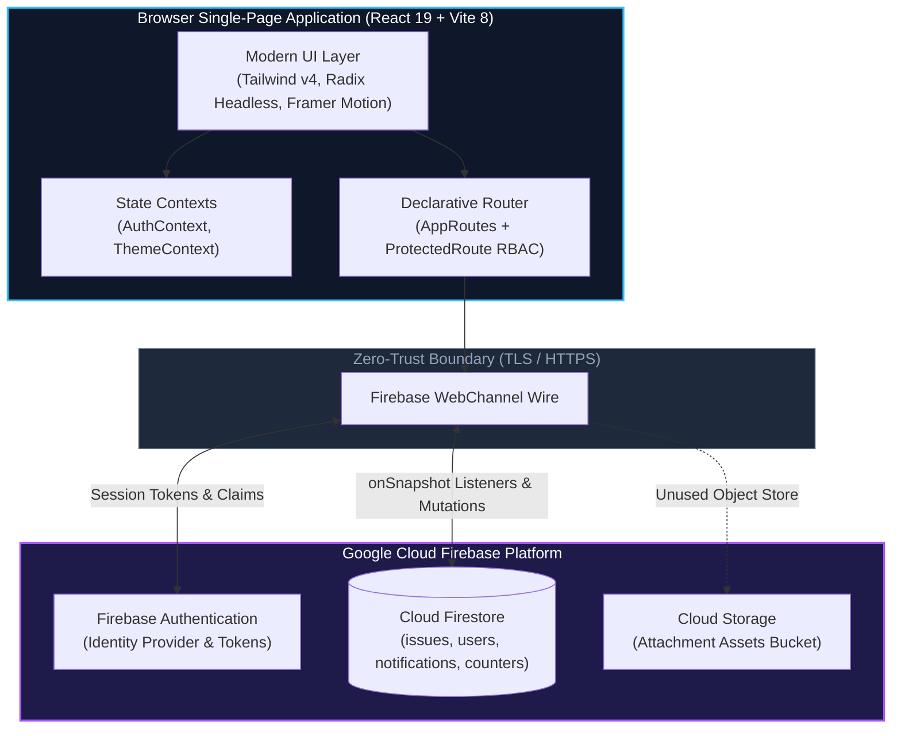
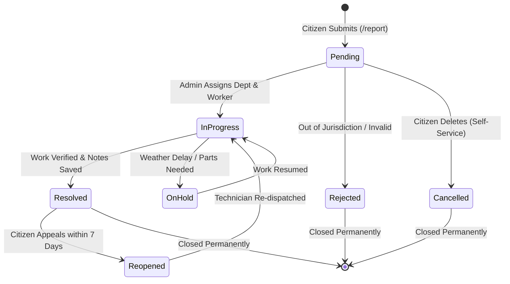

<div align="center">

# 🏙️ Civic-Connect
### *Next-Generation Civic Intelligence & Municipal Grievance Redressal*

<p align="center">
  
</p>

<!-- Live & Tech Badges -->
<p align="center">
  <a href="https://civic-connect-enim.vercel.app/"></a>
  <a href="https://react.dev/"></a>
  <a href="https://vitejs.dev/"></a>
  <a href="https://tailwindcss.com/"></a>
  <a href="https://firebase.google.com/"></a>
  <a href="https://github.com/chhavikant03/Civic-Connect"></a>
</p>

<!-- Navigation Matrix Bar -->
<p align="center">
  <b><a href="#-interactive-demo--visual-tour">Visual Tour</a></b> •
  <b><a href="#-key-features">Key Capabilities</a></b> •
  <b><a href="#-architecture-blueprint">Architecture</a></b> •
  <b><a href="#-live-lifecycle-state-machine">Lifecycle</a></b> •
  <b><a href="#-comprehensive-documentation-library">5 Master Manuals</a></b> •
  <b><a href="#-quickstart-guide">Quickstart</a></b> •
  <b><a href="#-security-audit--advisories">Security</a></b> •
  <b><a href="#-project-leadership--mentorship">Leadership</a></b>
</p>

<p align="center">
  <sub>Bridging citizens and local municipalities with real-time grievance tracking, sequential ticket indexing (<code>CMP-YYYY-XXXX</code>), geolocation tagging, and automated administrative triage.</sub>
</p>

</div>

## 🌿 Why Civic-Connect Matters

> *"A city works best when every resident has a voice that gets heard, and every municipal worker has the clarity to act."*

Most neighborhood issues—a broken streetlight on a dark lane, an overflowing dumpster near a school, or a water pipeline leak—often go unnoticed not because nobody cares, but because traditional reporting channels are fragmented, slow, and opaque. Citizens file grievances into black holes, never knowing if anyone received them. Municipal teams receive disorganized reports without accurate location coordinates or photo evidence.

**Civic-Connect bridges this gap with humanity, clarity, and speed:**
- **For Everyday Citizens:** Snap a photo, drop an automated GPS pin, describe what's wrong, and watch your issue progress step-by-step from dispatch to completion with zero guesswork.
- **For Municipal Field Teams:** Triage incoming concerns instantly, assign certified field crew members with direct contacts, and record real-time resolution notes with photos upon completion.
- **For Community Advocates & Mentors:** Build trust through total transparency, accountability metrics, and an active open-source ecosystem where contributors continuously elevate civic life.

---

## 🎬 Interactive Demo & Visual Tour

```mermaid
flowchart LR
    A["📱 Citizen Logs Issue<br/>(/report)"] -->|"Geo-Tag Coordinates & Category"| B["⚡ Cloud Firestore<br/>(Atomic Transaction CMP-2026-XXXX)"]
    B -->|"Real-Time Push Listener"| C["🏢 Municipal Admin Desk<br/>(/admin/reports)"]
    C -->|"Assign Worker & Department"| D["👷 Field Worker Dispatched<br/>(Phone + Work Order)"]
    D -->|"Log Resolution Notes"| E["✅ Ticket Resolved<br/>(Live Citizen Notification)"]

    style A fill:#0284c7,stroke:#0369a1,stroke-width:2px,color:#fff
    style B fill:#f59e0b,stroke:#d97706,stroke-width:2px,color:#fff
    style C fill:#6366f1,stroke:#4f46e5,stroke-width:2px,color:#fff
    style D fill:#8b5cf6,stroke:#7c3aed,stroke-width:2px,color:#fff
    style E fill:#10b981,stroke:#059669,stroke-width:2px,color:#fff
```

<div align="center">



</div>

---

## 🌟 Key Features

<table width="100%">
  <tr>
    <td width="33%" valign="top">
      <div align="center">
        <br/><br/>
      </div>
      <h4>📍 Geo-Tagged Grievances</h4>
      <p>Report public infrastructure defects with browser geolocation coordinates (latitude/longitude) and human-readable landmarks.</p>
    </td>
    <td width="33%" valign="top">
      <div align="center">
        <br/><br/>
      </div>
      <h4>🔢 Atomic Sequential IDs</h4>
      <p>Guaranteed monotonic counter transactions automatically generate clean civic ticket numbers formatted as <code>CMP-YYYY-XXXX</code>.</p>
    </td>
    <td width="33%" valign="top">
      <div align="center">
        <br/><br/>
      </div>
      <h4>⚡ Instant Push Alerts</h4>
      <p>Continuous Firestore <code>onSnapshot</code> listeners power unread notification counters, navbar badges, and dynamic reactive toasts.</p>
    </td>
  </tr>
  <tr>
    <td width="33%" valign="top">
      <div align="center">
        <br/><br/>
      </div>
      <h4>📊 Municipal Triage Desk</h4>
      <p>Multi-field filtering across 8 categories, 5 departments (Roads, Water, Sanitation, Electricity, Safety), and status indicators.</p>
    </td>
    <td width="33%" valign="top">
      <div align="center">
        <br/><br/>
      </div>
      <h4>👷 Field Worker Dispatch</h4>
      <p>Assign field technicians with validated contact numbers (<code>+91 XXXXXXXXXX</code>) directly linked to municipal departments.</p>
    </td>
    <td width="33%" valign="top">
      <div align="center">
        <br/><br/>
      </div>
      <h4>🌓 Modern Accessible UI</h4>
      <p>Accessible Radix UI dialogs, smooth Framer Motion layout transitions, mobile drawer navigation, and dark/light mode toggle.</p>
    </td>
  </tr>
</table>

---

## 🏗️ Architecture Blueprint

Civic-Connect follows a client-direct Backend-as-a-Service (BaaS) architecture:



---

## 🔄 Live Lifecycle State Machine

Complaints advance through an accountable state machine:



---

## 📖 Comprehensive Documentation Library

Our documentation is strictly organized into **5 master manuals** in [`docs/`](docs/documentation-hub.md) to eliminate fragmentation:

<div align="center">

```
docs/
├── documentation-hub.md           # 🧭 Manual 1: Documentation Hub, Vision, Personas & Glossary
├── architecture-and-data.md       # 🏗️ Manual 2: System Architecture, BaaS Trust & Firestore Schemas
├── features-and-workflows.md      # ⚡ Manual 3: Capability Matrix, State Machine & User Journeys
├── security-quality-and-issues.md # 🛡️ Manual 4: Threat Model, RBAC, Known Issues Register (CC-001..011)
└── operations-and-roadmap.md      # 🚀 Manual 5: Local Dev, Emulators, Deployment, Roadmap & PR Rules
```

</div>

| Manual | Target Audience | Primary Coverage |
|---|---|---|
| **[Manual 1: Documentation Hub](docs/documentation-hub.md)** | Newcomers & Evaluators | Mission, problem statement, citizen/admin responsibilities, terminology glossary, reading matrix. |
| **[Manual 2: Architecture & Data](docs/architecture-and-data.md)** | Architects & Engineers | BaaS trust boundaries, sequence diagrams with failure paths, complete Firestore schemas, indexes, ADRs. |
| **[Manual 3: Features & Workflows](docs/features-and-workflows.md)** | Product Teams & QA | 20+ feature status audit, complaint state machine, worker dispatch journeys, UI/UX and accessibility. |
| **[Manual 4: Security & Quality](docs/security-quality-and-issues.md)** | Security Reviewers & QA | Threat model, production Firestore rules, confirmed defects register (`CC-001` to `CC-011`), test cases. |
| **[Manual 5: Operations & Roadmap](docs/operations-and-roadmap.md)** | Maintainers & Contributors | Local setup, Firebase emulators, SPA rewrites, cloud budget controls, phased roadmap, PR guidelines. |

---

## 🚀 Quickstart Guide

Get the project running on your local machine in under 3 minutes:

### Prerequisites
- **Node.js:** v18.0.0 or higher (`node -v`)
- **Package Manager:** `npm` v9+ (`npm -v`)
- **Git:** v2.30+

```bash
# 1. Clone your fork of the repository
git clone https://github.com/chhavikant03/Civic-Connect.git
cd Civic-Connect

# 2. Install dependencies
npm install

# 3. Configure environment variables
cp .env.example .env

# 4. Start the development server
npm run dev
```

Visit **[http://localhost:5173](http://localhost:5173)** in your browser.

---

## 🛡️ Security Audit & Advisories

An independent architectural review established the following security register:

| ID | Severity | Finding Summary | Impact | Action Required |
|---|---|---|---|---|
| **CC-001** | `Critical` | Hardcoded admin credentials embedded in `AuthPage.jsx`. | Administrative account takeover. | Remove hardcoded email/password. |
| **CC-002** | `Critical` | User registration accepts caller-supplied `role` string. | Self-elevation to administrator. | Enforce roles via Custom Claims. |
| **CC-003** | `High` | Missing version-controlled `firestore.rules` in repository. | Database access unverified in Git. | Commit rules to project root. |
| **CC-004** | `High` | Issue created before notification failure triggers error toast. | Duplicate ticket submission. | Wrap operations in `writeBatch`. |
| **CC-005** | `High` | Live snapshot listener overwrites unsaved resolution notes. | Loss of uncommitted draft notes. | Guard textarea with dirty-state check. |

*Read complete remediation blueprints and test cases in **[Manual 4: Security & Quality](docs/security-quality-and-issues.md)**.*

---

## 👥 Project Leadership & Mentorship

<div align="center">

<table>
  <thead>
    <tr>
      <th align="center">Leadership Role</th>
      <th align="center">Name</th>
      <th align="center">Affiliation & Connect</th>
    </tr>
  </thead>
  <tbody>
    <tr>
      <td align="center"><b>Project Mentor</b></td>
      <td align="center"><b>Kartik Chilkoti</b></td>
      <td align="center">
        <a href="https://github.com/chhavikant03/Civic-Connect"></a>
      </td>
    </tr>
    <tr>
      <td align="center"><b>Project Admin & Creator</b></td>
      <td align="center"><b>Chhavi Kant</b></td>
      <td align="center">
        <a href="https://github.com/chhavikant03"></a>&nbsp;
        <a href="https://www.linkedin.com/in/chhavi-kant-959bb1306/"></a>
      </td>
    </tr>
  </tbody>
</table>

</div>

---

## 🤝 Contributing

We welcome open-source contributions from participants of **Winter of Code Social (WOCS)** and the global developer community!

1. **Find an Issue:** Browse our [GitHub Issues](https://github.com/chhavikant03/Civic-Connect/issues).
2. **Get Assigned:** Comment on the issue and wait for official maintainer assignment.
3. **Follow Standards:** Branch naming (`feature/*`, `fix/*`), Conventional Commits (`feat:`, `fix:`), and run `npm run lint`.
4. **Submit PR:** Open a Pull Request targeting `main` with clear screenshots and test evidence.

*See complete contribution guidelines in **[Manual 5: Operations & Roadmap](docs/operations-and-roadmap.md)**.*

---

<div align="center">

<p align="center">
  
</p>

⭐ **If you find Civic-Connect inspiring, consider giving this repository a star!** ⭐  
*Together, let's build cleaner, safer, and more connected communities.* 🏙️

</div>
