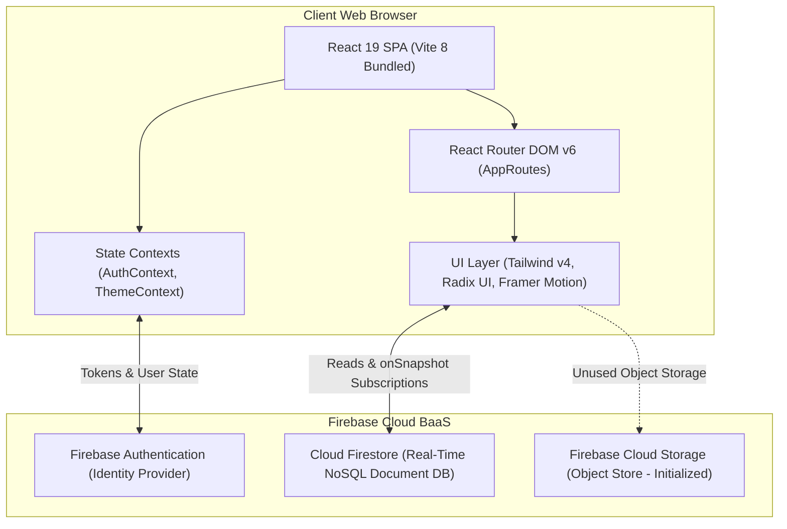
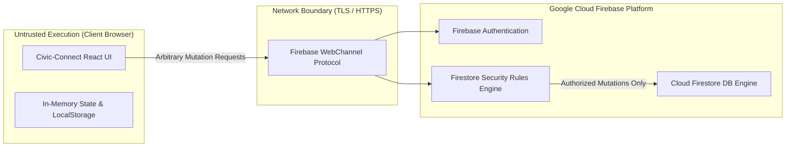
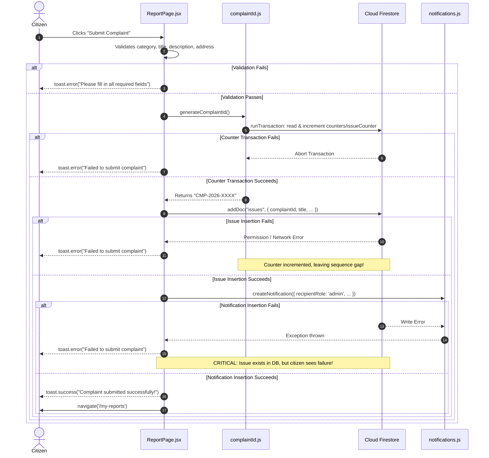
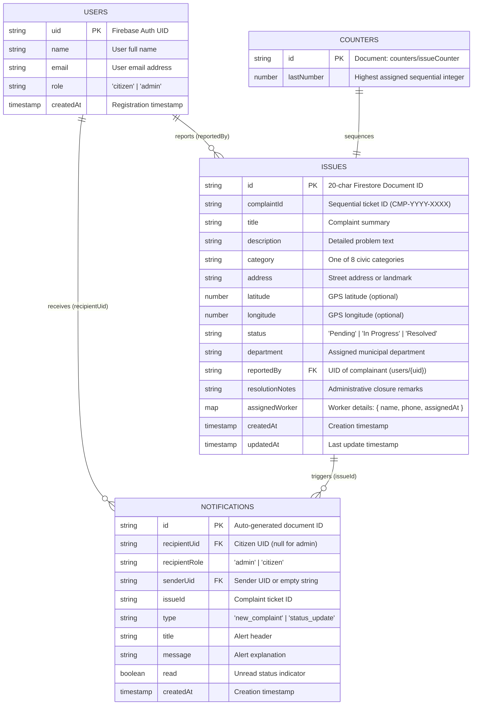

# System Architecture & Data Model

This manual covers the complete architectural design, client-to-cloud trust boundaries, failure paths, and Cloud Firestore database schema for Civic-Connect.

---

## 1. System Architecture

Civic-Connect is architected as a pure client-side Single-Page Application (SPA) interfacing directly with Google Cloud's Firebase platform without an intermediate application server.

### Component Hierarchy & Providers
1. **Entry Point (`main.jsx`):** Renders the root `<App />` component into the DOM.
2. **Context Providers (`App.jsx`):**
   - `ThemeProvider`: Toggles dark/light mode and synchronizes with browser `localStorage`.
   - `AuthProvider`: Listens to `onAuthStateChanged`, caches user roles from Firestore `users/{uid}`, and provides `login()`, `register()`, and `logout()`.
3. **Route Protection (`ProtectedRoute.jsx`):** Intercepts unauthorized route navigation by validating `user.role === requiredRole`.

---

## 2. Trust Boundaries & Security Architecture

Civic-Connect operates across a **Zero-Trust Client Boundary**:

> [!CAUTION]
> **Fundamental Security Principle:**
> React route guards (`<ProtectedRoute requiredRole="admin">`) govern only what the browser displays. **They provide zero database authorization.** In the absence of server-side `firestore.rules`, malicious users can directly call Firestore APIs to modify any document.

---

## 3. Complaint Submission Pipeline & Failure Paths

The submission of a new complaint involves three distinct sequential calls:

---

## 4. Cloud Firestore Data Schema

### Collection Specifications

#### 1. `users` (`users/{uid}`)
- Document ID matches the Firebase Auth `user.uid`.
- Fields: `name` (string), `email` (string), `role` (`'citizen'` or `'admin'`), `createdAt` (timestamp).
- *Vulnerability Note:* Roles are currently assigned directly by the client during signup.

#### 2. `issues` (`issues/{documentId}`)
- Stores all civic complaints.
- Fields: `complaintId` (`CMP-YYYY-XXXX`), `title`, `description`, `category`, `address`, `latitude`, `longitude`, `status`, `department`, `reportedBy`, `resolutionNotes`, `assignedWorker`, `createdAt`, `updatedAt`.
- Index Requirements: Composite index on `reportedBy` (Ascending) + `createdAt` (Descending).

#### 3. `notifications` (`notifications/{id}`)
- Dispatches alerts to citizens and municipal staff.
- Fields: `recipientUid`, `recipientRole`, `senderUid`, `issueId`, `type`, `title`, `message`, `read`, `createdAt`.
- Index Requirements: Composite index on `recipientRole` (Ascending) + `read` (Ascending).

#### 4. `counters` (`counters/issueCounter`)
- Atomic ticket counter.
- Field: `lastNumber` (monotonically increasing integer).

---

## 5. Architectural Decision Records (ADRs)

### ADR-0001: Client-Direct BaaS with Firebase (Accepted)
- **Context:** Rapid development of a real-time civic portal without backend infrastructure maintenance.
- **Decision:** Use Firebase Auth and Cloud Firestore directly from the browser.
- **Consequences:** Low hosting overhead, instantaneous real-time UI updates, but requires rigorous Firestore Security Rules to prevent client tampering.

### ADR-0002: Serverless Cloud Functions for Atomic Ingestion (Proposed)
- **Context:** Multi-step client writes risk sequence gaps and duplicate tickets upon network dropouts.
- **Decision:** Migrate complaint creation and role assignments to Firebase Cloud Functions (2nd Gen) with atomic transactions and Custom Auth Claims.
