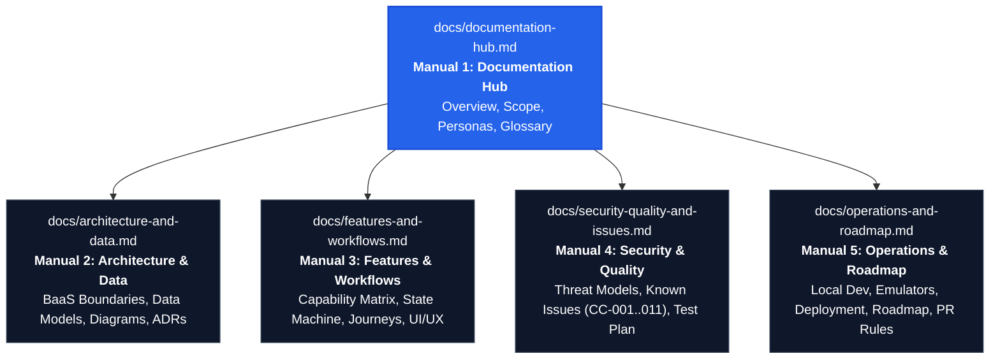

# 🏙️ Civic-Connect Documentation Hub

Welcome to the central documentation hub for **Civic-Connect**, an open-source civic grievance redressal and community engagement platform built on React 19, Vite 8, Tailwind CSS v4, and Cloud Firestore.

- **Current Repository:** [chhavikant03/Civic-Connect](https://github.com/chhavikant03/Civic-Connect)
- **Reviewed Commit:** `b0a4a1b7c88ce99238a0dd7d5f79e97aab1917fe`
- **Audit Date:** November 2026
- **Version:** `0.0.0` (Pre-production Prototype)

---

## 🧭 The 5 Core Documentation Manuals

To make the project immediately accessible and maintainable without documentation bloat, our technical specifications are organized into **5 master guides**:

```
docs/
├── documentation-hub.md                   # [Manual 1] Hub, Platform Overview & Glossary (This file)
├── architecture-and-data.md               # [Manual 2] System Architecture, BaaS Trust & Firestore Data Model
├── features-and-workflows.md              # [Manual 3] Capability Matrix, Lifecycles & User Journeys
├── security-quality-and-issues.md         # [Manual 4] Threat Model, RBAC, Known Issues Register & Tests
└── operations-and-roadmap.md              # [Manual 5] Local Setup, Emulators, Deployment, Roadmap & Contributing
```



---

## 🌟 1. Platform Overview & Scope

### 1.1 Problem Statement
Municipal administrations frequently struggle with disorganized, unformatted, and untracked citizen grievances. Residents reporting broken streetlights, hazardous potholes, or water pipe leakages face opaque telephone channels with zero status transparency. 

**Civic-Connect** bridges this divide by providing:
1. **Citizens:** A friction-free portal to submit geo-tagged, categorized complaints and track resolutions live.
2. **Administrators:** A centralized dashboard to triage complaints, dispatch field workers with contact numbers, and record formal resolution notes.

### 1.2 User Personas & Responsibilities
- **The Citizen:** Creates complaints (`Pending`), attaches geolocation coordinates, tracks live timeline updates, edits or deletes pending tickets, and receives real-time notifications.
- **The Administrator:** Monitors city-wide statistics, filters reports by category/status/department, assigns municipal departments, designates field technicians, records resolution notes, and advances status (`Pending` &rarr; `In Progress` &rarr; `Resolved`).
- **The Field Worker:** Modeled as structured metadata (`assignedWorker: { name, phone, assignedAt }`) attached by desk administrators. (Workers currently do not have independent logins).

### 1.3 Scope Boundaries (What is Real vs. Excluded)
- ✅ **In-Scope & Active:** Real-time Firestore sync, client-side RBAC route protection, sequential ticket ID generation (`CMP-YYYY-XXXX`), in-app toast alerts, and dark/light mode.
- ❌ **Explicitly Excluded:** No emergency dispatch (police/fire/ambulance), no official government partnership (this is an independent open-source software project), no image file upload pipeline (camera icon is currently placeholder), and no automated SMS gateway.

---

## 🏷️ 2. Feature Status Legend

Every feature documented across our specifications is labeled according to strict code-inspection evidence:

| Status Tag | Definition | Developer Meaning |
|---|---|---|
| `Implemented` | Backed by active code and Firestore mutations | Feature executes end-to-end in the web client. |
| `Partial` | Visuals and partial logic exist, but key pieces missing | Working UI, but lacks server authorization, persistence, or atomicity. |
| `Placeholder` | UI control exists without backend effect | Clicks show simulated `setTimeout` toasts; no data persists. |
| `Proposed` | Recommended future milestone | Planned architectural additions; no code exists yet. |
| `Unverified` | Dependent on external cloud console settings | Relies on Firestore rules or indexes not checked into Git. |

---

## 📖 3. Project Glossary

| Term | Definition | Context in Codebase |
|---|---|---|
| **Complaint / Report** | A formal citizen grievance for non-emergency public infrastructure repairs. | Firestore collection: `issues` |
| **Citizen** | Authenticated resident lodging complaints. | `role: 'citizen'`, Route: `/dashboard` |
| **Administrator** | Municipal officer reviewing and resolving issues. | `role: 'admin'`, Route: `/admin/*` |
| **Document ID** | 20-character auto-generated Firestore alphanumeric key. | Used as URL param: `/report/:id` |
| **Complaint ID** | Sequential ticket number formatted as `CMP-YYYY-XXXX`. | Displayed on badges and cards |
| **BaaS** | Backend-as-a-Service (Cloud Firestore & Firebase Auth). | Replaces custom Node/Express servers |
| **Field Worker** | Physical repair technician designated by an admin. | Nested object: `assignedWorker` |
| **Resolution Notes** | Detailed repair remarks recorded by an admin upon closure. | String field: `resolutionNotes` |

---

## 🚀 4. Quick Navigation Matrix

| I am a... | Start Here | Then Read | Key Takeaway |
|---|---|---|---|
| **New Contributor** | [Manual 5: Operations](operations-and-roadmap.md) | [Manual 3: Features](features-and-workflows.md) | How to run Vite locally and pick beginner issues. |
| **Code Reviewer / Architect** | [Manual 2: Architecture](architecture-and-data.md) | [Manual 4: Security](security-quality-and-issues.md) | Trust boundaries, data schemas, and the CC-001–CC-011 register. |
| **QA / Tester** | [Manual 4: Security & Quality](security-quality-and-issues.md) | [Manual 3: Features](features-and-workflows.md) | Test cases, permission boundaries, and state transitions. |
| **DevOps / Release Lead** | [Manual 5: Operations](operations-and-roadmap.md) | [Manual 2: Architecture](architecture-and-data.md) | SPA routing rewrites, Firebase indexes, and budget alerts. |
