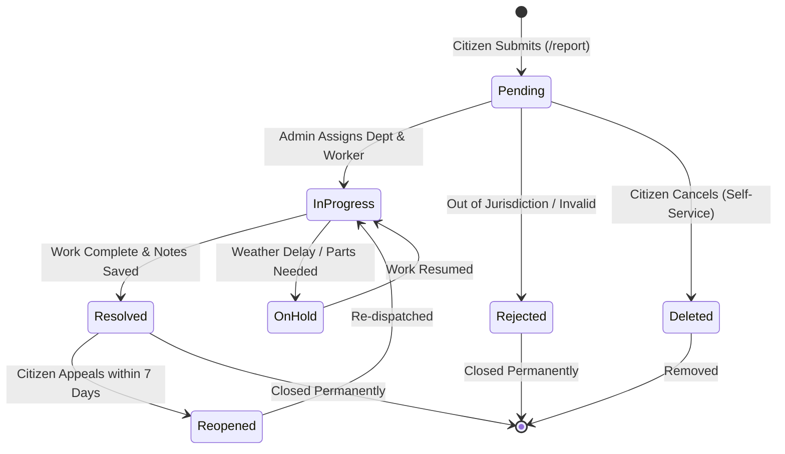

# Features, Workflows & UI/UX Audit

This manual provides an exhaustive audit of all user-facing screens, real-time workflows, state transitions, and accessibility benchmarks across Civic-Connect.

---

## 1. Feature Capability Matrix

Every screen and action in the application is evaluated below:

| Feature & Route | Target Role | Implementation Status | Functional Reality in Codebase | Traceable Source | Key Limitation | Recommended Fix |
|---|---|---|---|---|---|---|
| **Citizen Sign Up** (`/auth`) | Guest | **Implemented** | Creates Auth account and initializes `users/{uid}` with role. | [`AuthContext.jsx:56`](file:///d:/civic-connect/Civic-Connect/src/contexts/AuthContext.jsx#L56) | Client passes arbitrary role parameter. | Restrict role creation to `'citizen'`. |
| **Citizen Sign In** (`/auth`) | Citizen | **Implemented** | Authenticates user; verifies `role === 'citizen'`; navigates to `/dashboard`. | [`AuthPage.jsx:45`](file:///d:/civic-connect/Civic-Connect/src/pages/auth/AuthPage.jsx#L45) | Role check occurs in client JavaScript. | Verify role using Firebase Custom Claims. |
| **Admin Sign In** (`/auth`) | Admin | **Partial** | Pre-fills hardcoded credentials; redirects to `/admin/dashboard`. | [`AuthPage.jsx:116`](file:///d:/civic-connect/Civic-Connect/src/pages/auth/AuthPage.jsx#L116) | **Critical Security Flaw:** Hardcoded admin password in client. | Remove hardcoded admin credentials immediately. |
| **Complaint Creation** (`/report`) | Citizen | **Implemented** | Increments counter, saves document to `issues`, logs notification. | [`ReportPage.jsx:61`](file:///d:/civic-connect/Civic-Connect/src/pages/citizen/ReportPage.jsx#L61) | Non-atomic discrete writes; failure in notif causes duplicate risk. | Wrap in Firestore batch write. |
| **Location Capture** (`/report`) | Citizen | **Implemented** | Reads browser coordinates via `navigator.geolocation`. | [`ReportPage.jsx:41`](file:///d:/civic-connect/Civic-Connect/src/pages/citizen/ReportPage.jsx#L41) | No interactive map pin drop. | Add Leaflet / OpenStreetMap selector. |
| **Citizen Reports** (`/my-reports`) | Citizen | **Implemented** | Real-time `onSnapshot` filtered by `where('reportedBy', '==', uid)`. | [`MyReportsPage.jsx:53`](file:///d:/civic-connect/Civic-Connect/src/pages/citizen/MyReportsPage.jsx#L53) | Unbounded query; downloads full history. | Implement pagination (`limit(15)`). |
| **Complaint Edit** (`/my-reports`) | Citizen | **Implemented** | Modal updates title, desc, and address if status is `Pending`. | [`MyReportsPage.jsx:107`](file:///d:/civic-connect/Civic-Connect/src/pages/citizen/MyReportsPage.jsx#L107) | Status constraint enforced only in UI. | Enforce status check in `firestore.rules`. |
| **Complaint Delete** (`/my-reports`) | Citizen | **Implemented** | Confirmation dialog deletes document if status is `Pending`. | [`MyReportsPage.jsx:89`](file:///d:/civic-connect/Civic-Connect/src/pages/citizen/MyReportsPage.jsx#L89) | Leaves orphaned notifications behind. | Cascade delete notifications. |
| **Admin Reports** (`/admin/reports`) | Admin | **Implemented** | Lists all reports with multi-field client-side filters. | [`AdminReportsPage.jsx:72`](file:///d:/civic-connect/Civic-Connect/src/pages/admin/AdminReportsPage.jsx#L72) | Fetches all documents and runs N+1 user profile queries. | Introduce server-side composite filters and pagination. |
| **Status Progression** (`/admin/reports/:id`) | Admin | **Implemented** | Advances status (`Pending` &rarr; `In Progress` &rarr; `Resolved`). | [`AdminComplaintDetailsPage.jsx:101`](file:///d:/civic-connect/Civic-Connect/src/pages/admin/AdminComplaintDetailsPage.jsx#L101) | Strictly linear; cannot reject or reopen. | Add rejection and citizen appeal paths. |
| **Department Assign** (`/admin/reports/:id`) | Admin | **Implemented** | Dropdown selects from 5 departments; updates Firestore. | [`AdminComplaintDetailsPage.jsx:130`](file:///d:/civic-connect/Civic-Connect/src/pages/admin/AdminComplaintDetailsPage.jsx#L130) | No citizen alert on assignment. | Send notification to citizen. |
| **Worker Dispatch** (`/admin/reports/:id`) | Admin | **Implemented** | Modal saves normalized worker phone (`+91 XXXXXXXXXX`) and name. | [`AdminComplaintDetailsPage.jsx:170`](file:///d:/civic-connect/Civic-Connect/src/pages/admin/AdminComplaintDetailsPage.jsx#L170) | Workers lack user accounts or directory lookup. | Add formal `workers` collection. |
| **Resolution Notes** (`/admin/reports/:id`) | Admin | **Implemented** | Textarea saves admin remarks to Firestore. | [`AdminComplaintDetailsPage.jsx:147`](file:///d:/civic-connect/Civic-Connect/src/pages/admin/AdminComplaintDetailsPage.jsx#L147) | **Data Loss Bug:** Remote snapshot overwrites unsaved typing. | Add dirty-state tracking to textarea. |
| **Notifications Page** (`/notifications`) | Both | **Implemented** | Lists alerts; batch marks unread as read upon page load. | [`NotificationsPage.jsx:38`](file:///d:/civic-connect/Civic-Connect/src/pages/citizen/NotificationsPage.jsx#L38) | First admin to open clears alerts for all admins. | Create per-admin read receipts. |
| **Citizen Profile** (`/profile`) | Citizen | **Placeholder** | UI form for name, phone, address, and avatar. | [`ProfilePage.jsx:23`](file:///d:/civic-connect/Civic-Connect/src/pages/citizen/ProfilePage.jsx#L23) | Uses `setTimeout(800)` mock; no data saved. | Persist fields to `users/{uid}`. |
| **Admin Settings** (`/admin/settings`) | Admin | **Placeholder** | Municipality name, admin email, and toggle controls. | [`AdminSettingsPage.jsx:17`](file:///d:/civic-connect/Civic-Connect/src/pages/admin/AdminSettingsPage.jsx#L17) | Mock operation; no data saved. | Connect to Firestore `settings/general`. |

---

## 2. End-to-End Operational Lifecycle

Civic-Connect moves grievances through the following recommended state machine:

### Synthetic Timeline vs. Real Audit Events
> [!WARNING]
> **Auditability Flaw:**
> Currently in [`ComplaintDetailsPage.jsx:18-22`](file:///d:/civic-connect/Civic-Connect/src/pages/citizen/ComplaintDetailsPage.jsx#L18-L22), the status timeline is synthetically computed from the current status string. If an admin moves a complaint directly from `Pending` to `Resolved`, the UI falsely displays that intermediate review and assignment steps occurred. True auditability requires a dedicated `events` sub-collection.

---

## 3. UI, UX and Accessibility (WCAG 2.1) Audit

1. **Keyboard Accessibility & Modals:** Radix UI primitives provide accessible focus trapping and `Escape` key dismissal. However, several icon-only buttons (mobile menu, notification bell, profile camera) lack explicit `aria-label` tags.
2. **Color Contrast & Dark Mode:** Built with Tailwind v4 tailored palettes. Semantic badges (`success` for Resolved, `warning` for In Progress, `destructive` for Pending) ensure clear visual scannability across both light and dark themes.
3. **Reduced Motion:** Framer motion animations run unconditionally; the codebase should incorporate `useReducedMotion()` to respect user OS preferences.
4. **Mobile Navigation:** Supported via a responsive slide-over drawer ([`MobileSidebar.jsx`](file:///d:/civic-connect/Civic-Connect/src/components/layout/MobileSidebar.jsx)) on viewports `< 1024px`.
