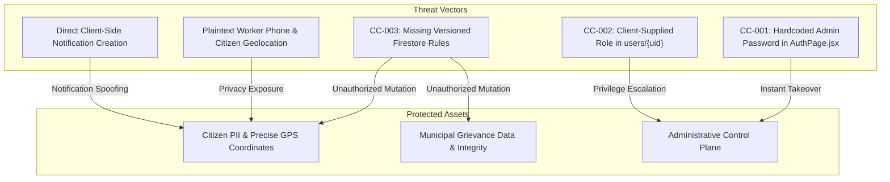

# Security, Quality Assurance & Known Issues

This manual details the security threat model, RBAC authorization boundaries, verified issues register (CC-001 through CC-011), and prioritized test plans.

---

## 1. Security Threat Model



### Public Client Config vs. Private Secrets
- **Firebase Web Config (`apiKey`, `projectId`):** Public client identifiers embedded in web bundles; not secret. Security relies strictly on server-side rules.
- **Administrative Credentials:** Confidential secrets. Exposing them in client code is a critical vulnerability.
- **Service Account Private Keys:** Root credentials. Never placed in client code or Git.

---

## 2. Verified Known Issues Register

| Issue ID | Priority | Status | Finding | Source Reference | Impact | Remediation |
|---|---|---|---|---|---|---|
| **CC-001** | Critical (P0) | Confirmed | Hardcoded administrative credentials embedded in login tab. | [`AuthPage.jsx:116`](file:///d:/civic-connect/Civic-Connect/src/pages/auth/AuthPage.jsx#L116) | Any web visitor can log in as admin immediately. | Remove hardcoded email/password from code. |
| **CC-002** | Critical (P0) | Confirmed | User registration accepts caller-supplied role string. | [`AuthContext.jsx:56`](file:///d:/civic-connect/Civic-Connect/src/contexts/AuthContext.jsx#L56) | Users can self-promote to `admin`. | Enforce roles via Custom Claims. |
| **CC-003** | High (P1) | Confirmed | Missing version-controlled `firestore.rules` in Git. | Repository Root | Database authorization is unversioned and unverified. | Commit `firestore.rules` and test via emulator. |
| **CC-004** | High (P1) | Confirmed | Issue created before notification failure triggers error toast. | [`ReportPage.jsx:70`](file:///d:/civic-connect/Civic-Connect/src/pages/citizen/ReportPage.jsx#L70) | Duplicate tickets when users retry after false error. | Wrap operations in a single `writeBatch`. |
| **CC-005** | High (P1) | Confirmed | Live snapshot listener overwrites unsaved resolution notes. | [`AdminComplaintDetailsPage.jsx:78`](file:///d:/civic-connect/Civic-Connect/src/pages/admin/AdminComplaintDetailsPage.jsx#L78) | Admin loses draft notes while actively typing. | Guard snapshot updates with dirty-state flag. |
| **CC-006** | High (P1) | Confirmed | All administrators share a single unread notification state. | [`AdminNotificationsPage.jsx:44`](file:///d:/civic-connect/Civic-Connect/src/pages/admin/AdminNotificationsPage.jsx#L44) | First admin clears notifications for entire desk. | Store per-admin read receipts. |
| **CC-007** | Medium (P2) | Confirmed | Profile & Settings forms simulate saves with `setTimeout`. | [`ProfilePage.jsx:25`](file:///d:/civic-connect/Civic-Connect/src/pages/citizen/ProfilePage.jsx#L25) | Changes are lost immediately upon refresh. | Wire form submissions to Firestore. |
| **CC-008** | Medium (P2) | Confirmed | Unbounded collection queries download entire database. | [`AdminReportsPage.jsx:73`](file:///d:/civic-connect/Civic-Connect/src/pages/admin/AdminReportsPage.jsx#L73) | Prohibitive read costs and browser lag at scale. | Implement cursor pagination (`limit(20)`). |
| **CC-009** | Medium (P2) | Confirmed | Timeline displays synthetic steps rather than audit events. | [`ComplaintDetailsPage.jsx:18`](file:///d:/civic-connect/Civic-Connect/src/pages/citizen/ComplaintDetailsPage.jsx#L18) | False reporting of review/assignment steps. | Introduce `issues/{id}/events` collection. |
| **CC-010** | Low (P3) | Confirmed | Database errors appear as zero-item empty states. | [`MyReportsPage.jsx:76`](file:///d:/civic-connect/Civic-Connect/src/pages/citizen/MyReportsPage.jsx#L76) | Misleads user into thinking no reports exist. | Render explicit error banner on query failure. |
| **CC-011** | Low (P3) | Confirmed | Profile camera button lacks file input and accessible label. | [`ProfilePage.jsx:46`](file:///d:/civic-connect/Civic-Connect/src/pages/citizen/ProfilePage.jsx#L46) | Inaccessible clickable element that does nothing. | Wire to file picker with `aria-label`. |

---

## 3. Required Firestore Security Rules

Deploy the following rules to secure the platform against unauthorized tampering:

```javascript
rules_version = '2';
service cloud.firestore {
  match /databases/{database}/documents {

    function isAuthenticated() {
      return request.auth != null;
    }

    function isAdmin() {
      return isAuthenticated() &&
        get(/databases/$(database)/documents/users/$(request.auth.uid)).data.role == 'admin';
    }

    match /users/{userId} {
      allow read: if isAuthenticated() && (request.auth.uid == userId || isAdmin());
      allow create: if isAuthenticated() && request.auth.uid == userId &&
                    request.resource.data.role == 'citizen';
      allow update: if isAuthenticated() && request.auth.uid == userId &&
                    request.resource.data.role == resource.data.role;
      allow delete: if false;
    }

    match /issues/{issueId} {
      allow read: if isAuthenticated() &&
                  (resource.data.reportedBy == request.auth.uid || isAdmin());
      allow create: if isAuthenticated() &&
                    request.resource.data.reportedBy == request.auth.uid &&
                    request.resource.data.status == 'Pending';
      allow update: if (isAuthenticated() && resource.data.reportedBy == request.auth.uid &&
                        resource.data.status == 'Pending' &&
                        request.resource.data.status == 'Pending') || isAdmin();
      allow delete: if isAuthenticated() && resource.data.reportedBy == request.auth.uid &&
                    resource.data.status == 'Pending';
    }

    match /notifications/{notificationId} {
      allow read: if isAuthenticated() &&
                  (resource.data.recipientUid == request.auth.uid ||
                   (resource.data.recipientRole == 'admin' && isAdmin()));
      allow update: if isAuthenticated() &&
                    request.resource.data.diff(resource.data).affectedKeys().hasOnly(['read']);
      allow create: if isAuthenticated();
      allow delete: if false;
    }

    match /counters/{counterId} {
      allow read, write: if isAuthenticated();
    }
  }
}
```

---

## 4. Prioritized Test Cases (QA Matrix)

1. **TC-SEC-01 (P0): Administrative Route Isolation**
   - *Test:* Log in as citizen &rarr; attempt to open `/admin/dashboard`.
   - *Pass:* Redirected to `/dashboard`; no admin data retrieved.
2. **TC-SEC-02 (P0): Role Tampering via Console**
   - *Test:* Citizen invokes `updateDoc(doc(db, 'users', uid), { role: 'admin' })`.
   - *Pass:* Denied with `PERMISSION_DENIED`.
3. **TC-DAT-01 (P1): Atomic Ingestion Failure**
   - *Test:* Submit complaint with simulated network drop on notification write.
   - *Pass:* Operation rolls back; no duplicate complaint on retry.
4. **TC-CON-01 (P2): Live Notes Draft Overwrite**
   - *Test:* Admin types notes; remote update arrives before saving.
   - *Pass:* Local textarea text is preserved without overwrite.
