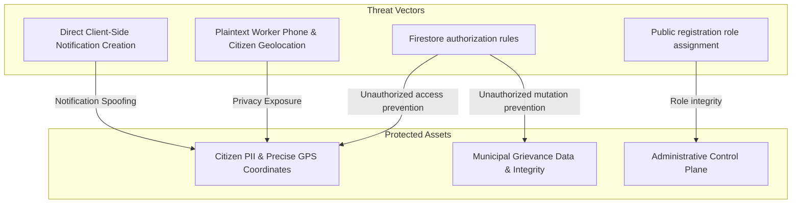

# Security, Quality Assurance & Known Issues

This manual summarizes the current security boundaries, the audit status of findings CC-001 through CC-011, and security regression checks. The findings below were checked against the repository on 2026-11-21; resolved entries are retained as an audit history.

---

## 1. Security Threat Model

### Public Client Config vs. Private Secrets
- **Firebase Web Config (`apiKey`, `projectId`):** Public client identifiers embedded in web bundles; not secret. Security relies strictly on server-side rules.
- **Administrative Credentials:** Confidential secrets. Exposing them in client code is a critical vulnerability.
- **Service Account Private Keys:** Root credentials. Never placed in client code or Git.

---

## 2. Findings Audit

| Issue ID | Priority | Audit status | Finding / current evidence |
|---|---|---|---|
| CC-001 | Critical (P0) | Resolved in current code | The login form authenticates with user-entered credentials; no hardcoded administrator password is present in [`AuthPage.jsx`](../src/pages/auth/AuthPage.jsx). |
| CC-002 | Critical (P0) | Resolved in current code | Public registration assigns the `citizen` role in [`AuthContext.jsx`](../src/contexts/AuthContext.jsx); the submitted role is not accepted. |
| CC-003 | High (P1) | Resolved in current repository | Firestore rules are versioned in [`firestore.rules`](../firestore.rules), with emulator rule tests in [`tests/rules/firestore.rules.test.js`](../tests/rules/firestore.rules.test.js). |
| CC-004 | High (P1) | Resolved in current code | Complaint creation, its timeline event, and the admin notification are written in the same transaction in [`ReportPage.jsx`](../src/pages/citizen/ReportPage.jsx). |
| CC-005 | High (P1) | Resolved in current code | The admin complaint listener preserves resolution notes while the editor is dirty in [`AdminComplaintDetailsPage.jsx`](../src/pages/admin/AdminComplaintDetailsPage.jsx). |
| CC-006 | High (P1) | Confirmed | Admin notifications are queried by `recipientRole == 'admin'`; marking them read updates the shared notification documents in [`AdminNotificationsPage.jsx`](../src/pages/admin/AdminNotificationsPage.jsx). A read receipt per administrator is not implemented. |
| CC-007 | Medium (P2) | Resolved in current code | Citizen profile changes call `updateUserProfile`, and admin settings persist through Firestore in [`ProfilePage.jsx`](../src/pages/citizen/ProfilePage.jsx) and [`AdminSettingsPage.jsx`](../src/pages/admin/AdminSettingsPage.jsx). |
| CC-008 | Medium (P2) | Resolved for admin reports | The admin reports table uses cursor-based pages in [`adminReportsQuery.js`](../src/firebase/adminReportsQuery.js); search and export use bounded, paginated fetches. |
| CC-009 | Medium (P2) | Resolved in current code | Complaint timelines subscribe to `issues/{id}/events` in [`ComplaintDetailsPage.jsx`](../src/pages/citizen/ComplaintDetailsPage.jsx); lifecycle writes create event documents in [`complaintLifecycle.js`](../src/firebase/complaintLifecycle.js). |
| CC-010 | Low (P3) | Resolved in current code | Query errors set an error state and show a retryable connection banner in [`MyReportsPage.jsx`](../src/pages/citizen/MyReportsPage.jsx). |
| CC-011 | Low (P3) | Confirmed | The profile photo button has an accessible label but no file picker or click handler in [`ProfilePage.jsx`](../src/pages/citizen/ProfilePage.jsx). |

---

## 3. Firestore Security Rules

The authoritative rules are maintained in [`firestore.rules`](../firestore.rules). Do not copy or deploy a separate rules example from this manual, because it can drift from the rules tested and shipped with the repository. Run `npm run test:rules` to execute the Firestore rules suite against the emulator; deploy with `npm run deploy:rules` only when an authorized maintainer intends to update the configured Firebase project.

---

## 4. Security Regression Checks

1. **TC-SEC-01 (P0): Administrative Route Isolation**
   - *Test:* Log in as citizen &rarr; attempt to open `/admin/dashboard`.
   - *Pass:* Redirected to `/dashboard`; no admin data retrieved.
2. **TC-SEC-02 (P0): Role Tampering via Console**
   - *Test:* Citizen invokes `updateDoc(doc(db, 'users', uid), { role: 'admin' })`.
   - *Pass:* Denied with `PERMISSION_DENIED`.
3. **TC-RULES-01 (P1): Firestore Rules Regression**
   - *Test:* Run `npm run test:rules`.
   - *Pass:* The emulator rules suite completes successfully.
4. **TC-CON-01 (P2): Live Notes Draft Preservation**
   - *Test:* Admin types notes; a remote complaint update arrives before saving.
   - *Pass:* The local textarea text is preserved while the editor is dirty.
